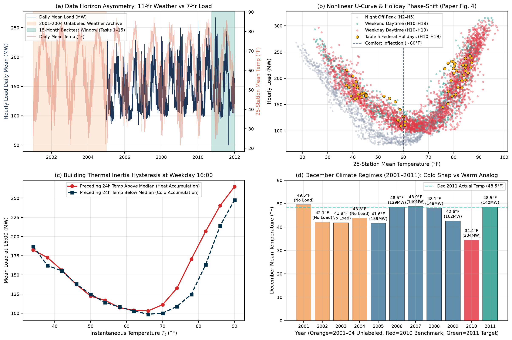
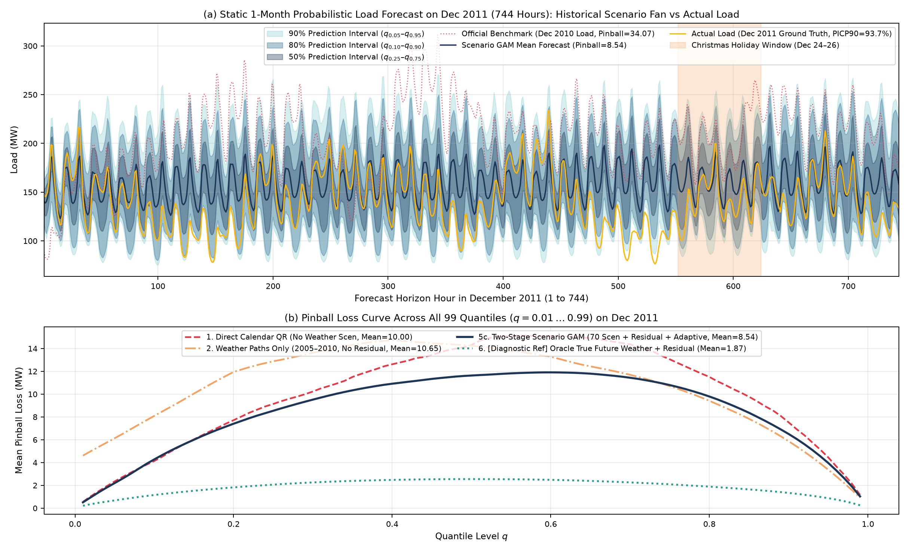
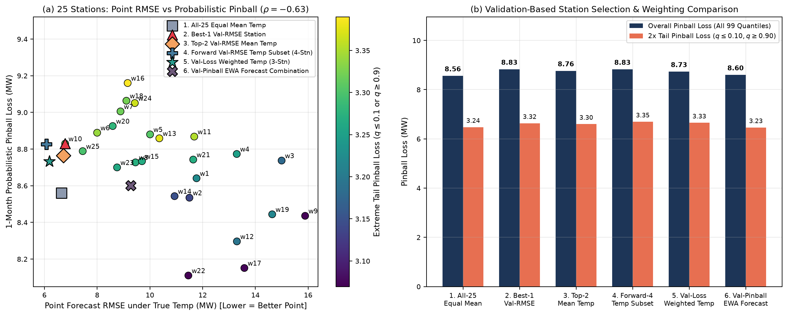
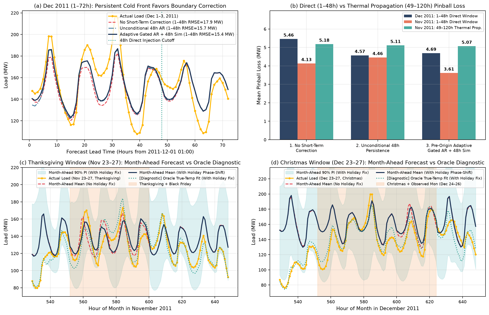
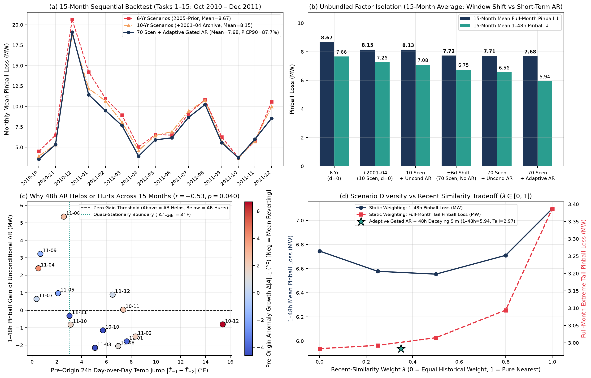

# GEFCom2014-L 月度电力负荷概率预测：历史天气情景多样性与预测起点近期信息平衡

> **选题来源**：Tao Hong, Pierre Pinson, Shu Fan, Hamidreza Zareipour, Alberto Troccoli, Rob J. Hyndman (2016), *"Probabilistic energy forecasting: Global Energy Forecasting Competition 2014 and beyond"*, **International Journal of Forecasting**, 32(3), 896–913（第 4 章：Probabilistic electric load forecasting, `GEFCom2014-L` & `GEFCom2014-E`）。
>
> **核心主线**：围绕**“月初一次性预测未来整月（720–744 小时）逐时负荷分布（99 个分位数）”**的任务设定，拒绝复杂模型堆砌，采用可解释的**分时惩罚样条广义加性模型（Hourly Penalized Spline GAM）＋ 两阶段情景残差建模**，重点研究：**月度负荷预测中，历史天气情景应该保留多少多样性，又应在多大程度上贴近预测起点的近期天气与负荷状态？特别是为什么同一个月首 48 小时短期修正在 2011 年 12 月有效、在 2011 年 11 月失效，以及如何在预测前（ex ante）判断是否应当采用它？**

---

## 目录

1. [核心研究问题与实证发现摘要](#1-核心研究问题与实证发现摘要)
2. [仓库目录结构](#2-仓库目录结构)
3. [环境配置与一键复现](#3-环境配置与一键复现)
4. [核心实验图表速览](#4-核心实验图表速览)
5. [团队协作与分工指南](#5-团队协作与分工指南)

---

## 1. 核心研究问题与实证发现摘要

完整推导、实现细节修正与实验分析见 [**Report.md**](./Report.md)：

1. **拆解消融与 15 个月顺序回测：收益究竟来自“天气窗口平移”还是“月首短期修正”？**
   - 在全部 **15 个竞赛任务月（`Task 1: 2010-10` 至 `Task 15: 2011-12`，共 10,968 小时）** 的严格时序回测中：
     - 引入 `2001–2004` 无负荷标签历史气象库（`6 年 → 10 年同日情景`）使 15 个月平均尾部 Pinball Loss 下降 **17.2%（`3.96 → 3.28 MW`）**，全月平均 Pinball Loss 下降 **6.0%（`8.67 → 8.15 MW`）**。
     - 将混在一起的改动拆开后发现：**全月总体损失的改善（`8.15 → 7.72 MW`，2011 年 12 月从 `9.99` 降至 `8.58 MW`）超过 95% 来自 $\pm 6$ 天天气过程窗口平移（扩充至 70 条情景）**，而非 48 小时短期修正（单独加短期修正仅使 15 个月全月均值从 `8.15` 变为 `8.13 MW`）。
   - 同时修复了早期版本中“近 45 天预测中心偏移量 `recent_offset` 与 3 年残差分布相互抵消 85%”的问题，将预测中心校准与零中位数条件误差分布严格解耦。

2. **为什么月首 48 小时修正在 2011 年 12 月有效（`5.46 → 4.57`），在 11 月却失效（`4.13 → 4.46`）？**
   - **机理解析**：2011 年 11 月预测起点前（10 月 30–31 日）虽有偏冷 `-9.2°F` 的早寒潮，但在 10 月 31 日后半程**冷异常已在快速消退（$\Delta |A|_{-1} = -4.31^\circ\text{F}$）**，并于 11 月 1 日回暖跨入 `55°F–60°F` 的热舒适死区，采暖负荷骤降；无条件持续性修正不仅锁死了过时的冷异常，还因逐条替换情景首日温度压缩了 $87\%\text{–}99\%$ 的情景间离散度（使 90% 区间宽度从 `54.85 MW` 坍缩至 `41.16 MW`）。相反，2011 年 12 月预测起点前（11 月 30 日）为刚入境且维持稳定的新冷气团（$\Delta |A|_{-1} = +0.47^\circ\text{F}$），短期持续性得以生效。
   - **15 个月规律与预测前自适应门控**：在全部 15 个月上，预测前 48 小时日际温度跳变 $|\Delta T_{-24\text{h}}|$ 与无条件短期修正收益呈显著负相关（$r = -0.53, p = 0.040$；准稳态边界 5 战全胜，锋面过境/异常衰减边界 10 战 8 负）。通过**预测前稳定性自适应门控（Pre-Origin Regime-Stability Gating）＋ 48 小时时域衰减相似情景加权**，11 月 `1–48h` Pinball 从 `4.13`（无条件修正 `4.46`）大幅降至 **`3.61 MW`（改善 12.5%）**，15 个月平均 `1–48h` Pinball 从 `6.75` 降至 **`5.94 MW`（改善 12.0%）**，且不损害全月尾部覆盖（`PICP90 = 87.7%`）。

3. **直接修正（1–48h）与热惯性传递（49–120h）分离及验证集选站对比**
   - 通过 `freeze_thermal_inertia_after_cutoff` 对照实验明确区分了 **`1–48h` 直接温度修正窗口**、**`49–120h` 经由 24h/72h 滑动积温特征的滞后传递窗口**与 **`121h–End` 完全未受影响窗口**。
   - 统一了验证集选站与测试集评估对象：25 站等权平均（`8.56 MW`）与验证集 Pinball EWA 预测组合（`8.60 MW`，尾部最优 `3.23 MW`）优于按点预测 RMSE 选出的温度子集（`8.73–8.83 MW`，其 Oracle 点预测 RMSE 最优达 `6.07 MW`），印证了点预测选站与概率预测目标的差异。

---

## 2. 仓库目录结构

```text
load-prediction/
├── README.md                         # 项目总览、复现指南与团队协作说明
├── Report.md                         # 完整研究报告（问题收敛、实现修正、15月回测与机理解析）
├── docs/
│   └── Paper_Section4_Reference.md   # 论文第 4 章原文与 Table 5/6 整理
├── requirements.txt                  # Python 依赖包列表
├── Data/
│   ├── figs/                         # 论文第 4 章原始配图 (Fig2.jpg ~ Fig7.jpg)
│   └── Load/                         # GEFCom2014-L 原始数据集 (Task 1..15 及 Task 15 真值)
├── src/
│   ├── __init__.py
│   ├── data_loader.py                # 数据整合、时间戳对齐、Table 5 联邦节假日与桥接日特征
│   ├── metrics.py                    # 99分位数 Pinball Loss（总体/尾部/中心）、RMSE/MAE/MAPE/PICP
│   ├── models.py                     # 分时样条 GAM、零中心残差合成、预测前门控与时域衰减相似加权
│   ├── station_selection.py          # 25气象站全扫描与验证集选站/温度加权/预测组合对比
│   └── run_experiments.py            # 实验主入口：运行全部实验、15月回测并输出图表与逐时预测
└── results/
    ├── figures/                      # 自动生成的 5 张核心实验可视化图 (fig1 ~ fig5)
    ├── tables/                       # 自动生成的 8 张实验与15个月回测定量 CSV 表格
    └── predictions/                  # 15个月逐小时分位数预测归档 (CSV + NPZ + JSON 配置清单)
```

---

## 3. 环境配置与一键复现

推荐使用 `uv` 或标准 `venv` + `pip` 创建虚拟环境（Python 3.10+ 均可）：

```bash
# 方式一：使用 uv（推荐）
uv venv .venv
uv pip install -r requirements.txt
MPLCONFIGDIR=/tmp PYTHONPATH=. .venv/bin/python -m src.run_experiments

# 方式二：使用标准 python venv
python3 -m venv .venv
source .venv/bin/activate
pip install -r requirements.txt
MPLCONFIGDIR=/tmp PYTHONPATH=. python -m src.run_experiments
```

---

## 4. 核心实验图表速览

详细分析与数据表格见 [**Report.md**](./Report.md)。

### 图 1：场景物理特征探索与论文 Fig. 2–4 复刻


### 图 2：实验一 —— 2011 年 12 月静态概率预测扇形图与 99 分位数 Pinball Loss 曲线


### 图 3：实验二 —— 25 气象站点预测 vs. 概率预测异质性及验证集选站策略对比


### 图 4：实验三 —— 直接修正（1–48h）与热惯性传递（49–120h）及节假日月前预测 vs. Oracle 对照


### 图 5：实验四 —— 15 个月顺序回测、拆解消融、预测前锋面门控机理与相似情景加权权衡


---

## 5. 团队协作与分工指南

1. **逐小时误差审计与极端失败案例定位**：
   - 直接读取 [`results/predictions/hourly_summary_15months.csv`](./results/predictions/hourly_summary_15months.csv) 与 [`results/predictions/quantiles_99_15months.npz`](./results/predictions/quantiles_99_15months.npz)，可按 `pinball_hour` 排序检索 15 个月中损失最高的极端寒潮日（如 `2010-12` 寒潮周）或夏季热浪日，用于答辩 PPT 的案例剖析。
2. **报告与 PPT 叙事建议**：
   - 紧扣**“历史情景多样性 vs. 预测起点近期信息平衡”**主线：先用拆解消融说明全月收益主要来自 $\pm 6$ 天天气窗口平移，再用 `2011-11` 与 `2011-12` 的鲜明反差引出“预测前锋面跳变与均值回归判别”，最后用 15 个月顺序回测闭环验证。
