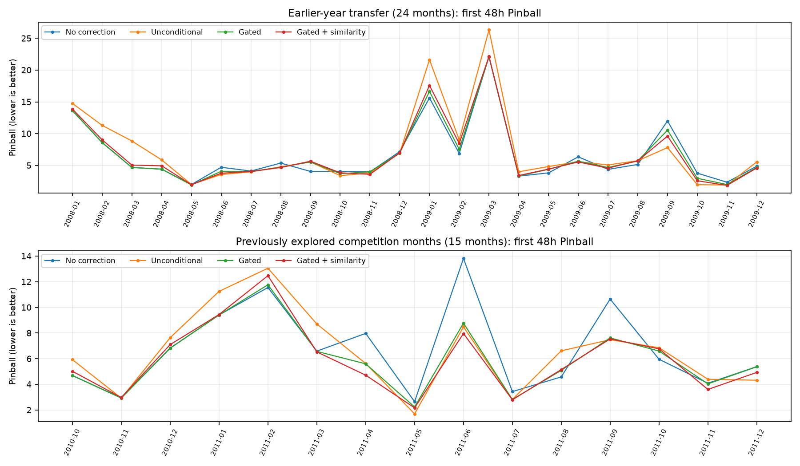

# 近期信息可信度与天气情景多样性：39个月验证报告

本轮先验证队友规则，再选择性合并代码。主要发现是：门控能明显减轻无条件近期修正的损失，但相对“不修正”的收益跨年份并不稳定；额外相似性加权在更早年份没有表现出可靠增益。保持温度情景差异有助于改善过窄区间，但不保证 Pinball 更低。因此保留全部对照，不把最复杂方案自动设为默认。

## 1. 课题与数据处理流程

月初不知道未来整月天气，需要一次性输出未来各小时负荷的99个分位数。我们从历史年份构造多条可能天气过程，再用同一个负荷模型转换为负荷分布。研究重点是：近期天气应该影响多少、影响多久，以及修正中心时是否应保留不同天气可能性。

GEFCom2014-L含一个匿名负荷区域、25个匿名气象站。气温为2001—2011年，负荷为2005—2011年，共96,408小时、61,344个负荷标签。各月按业务小时1—24切分，2011年2月为672小时；原始日期字符串未补零，不能直接按模糊字符串解析或去重。

流程：逐行核对原始时间 → 确定月初起点 → 隐藏目标月全部天气/负荷并截掉后续月份 → 仅用过去标签拟合固定的分时样条Ridge → 提取完整结束于起点前的历史天气过程 → 按固定配置修正/加权 → 合成条件残差并输出99分位数 → 保存完整预测 → 用独立真值文件评分。

## 2. 先验证原规则，再决定合并

第一阶段仅加入可选实验开关，默认行为保持队友0506c2b的实现。已用原15个月表格做90项指标比较，默认结果一致到1e-9。随后冻结门控常数和所有配置，在2008—2009年24个月与原竞赛15个月上回测，共39个月，不进行阈值搜索。

下表为第一阶段每个月首48小时损失的均值。原竞赛15个月已经用于探索和规则设计；更早年份检验的是回顾性时间迁移，不能称为真正的未来盲测。

| 时期 | 方案 | 首48小时Pinball | 相对不修正的变化 | 改善月份 |
| --- | --- | --- | --- | --- |
| 2008—2009（24月） | 不作近期修正 | 6.5472 | +0.00% | 0/24 |
| 2008—2009（24月） | 原方案：无条件修正 | 7.2357 | +10.52% | 11/24 |
| 2008—2009（24月） | 原方案：仅门控 | 6.5101 | -0.57% | 13/24 |
| 2008—2009（24月） | 原方案：门控＋衰减相似加权 | 6.5463 | -0.01% | 13/24 |
| 已探索竞赛月份（15月） | 不作近期修正 | 6.7457 | +0.00% | 0/15 |
| 已探索竞赛月份（15月） | 原方案：无条件修正 | 6.5555 | -2.82% | 7/15 |
| 已探索竞赛月份（15月） | 原方案：仅门控 | 6.0290 | -10.63% | 10/15 |
| 已探索竞赛月份（15月） | 原方案：门控＋衰减相似加权 | 5.9363 | -12.00% | 8/15 |

队友混合方案原先约12%的月初平均改善没有稳定迁移到更早年份。仅门控在2008—2009年相对不修正也仅有很小改善，但明显优于无条件修正。这支持将“减少错误干预”作为门控的主要研究价值，而不是宣称它能持续提高预测精度。

## 3. 选择性合并后的相同回测

合并了上轮的逐行时间校验、官方基线日期/分位数检查、按实际训练截止时刻计算样本年龄、统一节假日日型、拒绝错位/非有限/交叉分位数评分，以及完整预测与版本记录。

同时修复加权与未加权采用不同经验分位数口径的问题：共用一个加权分位数函数，等权与numpy.quantile一致，权重趋近等权时输出连续。无残差分支现在也实际使用情景权重。中心/残差解耦已由队友实现，予以保留。

没有整包合并旧分支：不引入另一套72小时上下文加权，不改变队友的趋势项默认设定，不改变默认预测策略，不把旧24个月成绩混入新版表格。继承的2008年封顶时间基函数是经验假设，不是已经识别出的经济或产业机制。

下表是**当前合并实现**，首48小时各月长度相同；整月按小时合并，点预测用中位数。代码校正共同改变了绝对数值，不能把与上一节的差额归因于门控或加权。

| 时期 | 方案 | 首48小时Pinball | 整月Pinball | 首48小时覆盖率90 | 改善月份 |
| --- | --- | --- | --- | --- | --- |
| 2008—2009（24月） | 不作近期修正 | 6.5628 | 7.1881 | 92.0% | 0/24 |
| 2008—2009（24月） | 原方案：无条件修正 | 7.2623 | 7.2346 | 71.1% | 10/24 |
| 2008—2009（24月） | 原方案：仅门控 | 6.5257 | 7.1853 | 86.9% | 13/24 |
| 2008—2009（24月） | 原方案：门控＋衰减相似加权 | 6.5828 | 7.1853 | 86.4% | 12/24 |
| 已探索竞赛月份（15月） | 不作近期修正 | 6.7046 | 7.7289 | 88.1% | 0/15 |
| 已探索竞赛月份（15月） | 原方案：无条件修正 | 6.5214 | 7.7172 | 71.4% | 7/15 |
| 已探索竞赛月份（15月） | 原方案：仅门控 | 6.0236 | 7.6833 | 89.4% | 10/15 |
| 已探索竞赛月份（15月） | 原方案：门控＋衰减相似加权 | 5.9475 | 7.6856 | 89.0% | 8/15 |

## 4. 门控与情景差异是否能分开

新增四组温度专用对照：固定/门控修正强度 × 逐条锚定/整体平移。它们共用相同负荷模型、天气库、48小时截断和36小时半衰期；统一关闭负荷残差修正、残差收缩和相似性加权，避免多种机制混在一起。另保留完全不修正基线。

逐条锚定会将每条天气过程拉向最近一天，直接缩小情景间差异；整体平移为所有温度情景加上相同的逐时改变量，保持同一时刻的温差。自动测试已检验这一性质，但通过非线性负荷模型之后，负荷区间宽度仍可能改变。

| 时期 | 温度专用对照 | 首48小时Pinball | 覆盖率90 | 区间宽度MW |
| --- | --- | --- | --- | --- |
| 2008—2009 | 温度对照：固定强度／逐条锚定 | 7.2472 | 73.1% | 50.11 |
| 2008—2009 | 温度对照：门控强度／逐条锚定 | 6.5306 | 85.7% | 63.02 |
| 2008—2009 | 温度对照：固定强度／整体平移 | 6.9058 | 90.7% | 71.52 |
| 2008—2009 | 温度对照：门控强度／整体平移 | 6.5387 | 91.4% | 71.51 |
| 已探索竞赛月份 | 温度对照：固定强度／逐条锚定 | 6.4098 | 75.8% | 52.26 |
| 已探索竞赛月份 | 温度对照：门控强度／逐条锚定 | 6.0835 | 88.6% | 66.98 |
| 已探索竞赛月份 | 温度对照：固定强度／整体平移 | 6.3847 | 90.8% | 74.53 |
| 已探索竞赛月份 | 温度对照：门控强度／整体平移 | 6.1342 | 91.8% | 75.22 |

保持温度差异可以缓解区间过窄；在已门控条件下，整体平移的Pinball未必优于逐条锚定。结果体现“位置偏差—分布宽度—覆盖率”的权衡，不能简单写成“保留更多多样性必然更准”。

单因素配对变化如下，负数代表新方案改善。完整月份和后续时距窗口均保存在paired_effects.csv，没有排除失败月份。

| 时期 | 单因素改变 | 平均月度Pinball变化 | 改善月份 |
| --- | --- | --- | --- |
| 已探索竞赛月份 | extra_similarity | -0.0761 | 8/15 |
| 已探索竞赛月份 | gate_center | -0.2505 | 9/15 |
| 已探索竞赛月份 | gate_individual | -0.3263 | 8/15 |
| 已探索竞赛月份 | geometry_fixed | -0.0251 | 7/15 |
| 已探索竞赛月份 | geometry_gated | +0.0507 | 3/15 |
| 2008—2009 | extra_similarity | +0.0570 | 10/24 |
| 2008—2009 | gate_center | -0.3671 | 18/24 |
| 2008—2009 | gate_individual | -0.7165 | 16/24 |
| 2008—2009 | geometry_fixed | -0.3414 | 13/24 |
| 2008—2009 | geometry_gated | +0.0080 | 8/24 |

## 5. 表述与评估边界

- 门控常数3.2°F、0.45、−1.5°F、2.0°F均继承并冻结；本轮没有搜索最优阈值。2008—2009年是向更早时期迁移，不等同于规则先于未来样本设计。后续真正验证应让阈值仅由每个起点之前的开发月份确定。
- 不修正同样是正式对照。门控相对一个有害修正的大幅改善，并不能自动解释为相对原预测具有同样大的收益。
- 相似性混合权重按指数衰减。第120小时仍约有6.2%的相似性混合，不能写成“120小时后100%恢复均匀”。
- 第48小时后停止直接改温度，积温/滞后特征还会传递影响；无相似加权时第121小时起不再受该温度改动影响。混合方案还有持续衰减的权重影响，不能对它声称后续分位数完全不变。
- 分位数经验残差仍来自样本内拟合，保留原0.85缩放和19个代表残差样本；不是严格的样本外区间校准。若改校准方法，要先用过去月份估计，再验证。
- 温度跳变与收益的相关性是探索性证据，当前数据没有锋面或冷气团标签；不把温度模式当成已证明的天气系统机理。不把单个月份损失降低称为统计显著。
- 单区域、重叠的历史情景和相邻月份均限制泛化解释；小时边际分位数不代表整月联合路径已经校准。

## 6. 复核与复现

11项自动检查涵盖原始行顺序、15个官方基线、闰年三月和2月29日、未来真值隐藏后重新训练/预测不变、权重趋零连续性、无残差加权分支、近期位置偏移不被抵消、节假日日型统一、批量/单条预测一致，以及整体平移保留温度差异。

本轮保存并重新读取312份完整预测，复算1248组窗口指标；核对18240条历史情景记录、起止时间和权重和。代码/数据哈希匹配，全年汇总的小时权重与RMSE合并方式也已核对。

运行命令见README。results/boundary_before_merge保留原规则迁移证据，results/boundary_merged是当前实现的正式结果；原results/tables、results/figures及results/predictions对应0506c2b历史探索，不能作为新实现成绩。
