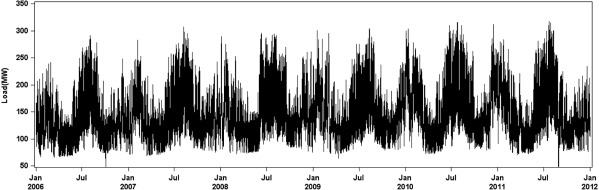
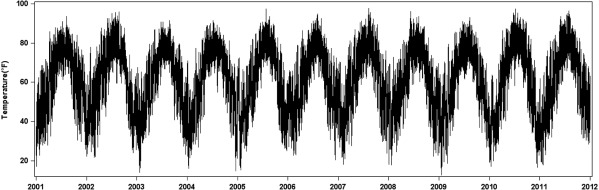
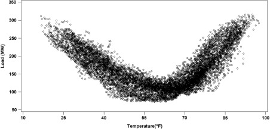
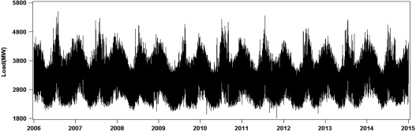
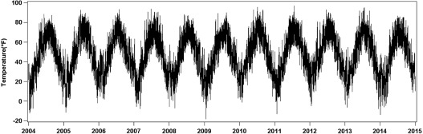
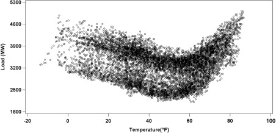

# 论文第 4 章原文参考：Probabilistic Electric Load Forecasting (GEFCom2014-L & GEFCom2014-E)

> 摘自：Tao Hong, Pierre Pinson, Shu Fan, Hamidreza Zareipour, Alberto Troccoli, Rob J. Hyndman (2016), *"Probabilistic energy forecasting: Global Energy Forecasting Competition 2014 and beyond"*, **International Journal of Forecasting**, 32(3), 896–913.  
> 原文链接：<https://www.sciencedirect.com/science/article/pii/S0169207016000133#s000055>

---

## 4.1. Problem and data description

The aim of the GEFCom2014-L was to forecast the quantiles of hourly loads for a US utility on a rolling basis. The forecast horizon was one month. Hourly historical load and weather data for the utility were provided. In addition to the data provided by the competition organizer, the contestants were also allowed to use US federal holiday information, including the dates listed in **Table 5**.

### Table 5. US federal holidays

| Holiday name | Date |
| :--- | :--- |
| New year’s day | January 1 |
| Birthday of Martin Luther King, Jr. | Third Monday in January |
| Washington’s birthday (Presidents’ day) | Third Monday in February |
| Memorial day | Last Monday in May |
| Independence day | July 4 |
| Labor day | First Monday in September |
| Columbus day | Second Monday in October |
| Veterans day | November 11 |
| Thanksgiving day | Fourth Thursday in November |
| Christmas day | December 25 |

The first data release on August 15th included 69 months of hourly load data (from January 2005 to September 2010) and 117 months of hourly weather data (from January 2001 to September 2010). Starting from the second data release, we made one month of hourly load and weather data available to the contestants each week as the solution of the previous week. The load forecasting track involved a total of 11 years of weather data and five years of load data.

Fig. 2, Fig. 3 show the load and temperature series, respectively. Fig. 4 shows a scatter plot of the load and temperature in 2010. The three figures depict the salient features that are typically studied in the load forecasting literature.

* 
* 
* 

In addition to the common challenges mentioned in the introduction section, we also designed the load forecasting track to address a few more:
1. **Weather station selection.** We provided 25 weather stations but no identification of their geographical locations. We expected that the contestants would develop some advanced algorithms for selecting weather stations. This was similar to the setup of the hierarchical load forecasting track in GEFCom2012.
2. **Multi-horizon load forecasting.** We chose one-month-ahead load forecasting as the competition topic, so that there was some room for the contestants to develop short-term load forecasting models to improve the scores for forecasts a few days ahead.
3. **Scenario generation.** Ten years of weather data were available to the contestants at the beginning of the evaluation period. We expected that some of the contestants would investigate the weather scenario generation methods for probabilistic load forecasting.

---

## 4.2. Fall 2015 in-class probabilistic load forecasting competition (GEFCom2014-E)

Tao Hong from UNC Charlotte organized an in-class probabilistic load forecasting competition in Fall 2015, which was also open to external participants. Since this in-class competition was an extended version of GEFCom2014-L, we denote it as **GEFCom2014-E** in this paper. In total, 16 teams joined the competition, including seven external teams. The setup of this in-class competition was similar to that of GEFCom2014-L. The topic was one-year-ahead probabilistic load forecasting. The competition included five tasks. Six years of hourly temperature data and four years of hourly load data were provided in the first task, then one year of hourly temperature and load data was released incrementally for each of the following four tasks. Fig. 5, Fig. 6 show the load and temperature series respectively. Fig. 7 shows the scatter plot of the load and temperature.

* 
* 
* 

---

## 4.3. Summary of the methods

A total of 16 teams beat the benchmark and submitted final reports in GEFCom2014-L. The top five teams submitted papers to this special issue. In GEFCom2014-E, a total of eight teams were eligible on the final leaderboard. The team Ziel Florian, which took second place, was invited to submit a paper to this special section. Ziel Florian’s forecast was compared with the benchmarks developed by Bidong Liu, a top-8 team in GEFCom2014-L. **Table 6** summarizes seven aspects of the methods used by the seven teams. The first four are forecasting techniques, data cleansing methods, forecast combination methods and integration methods, which were mentioned as the four main challenges in the introduction section. The last three are the three specific challenges for the load forecasting track, namely weather station selection methods, multi-horizon forecasting methods, and scenario generation methods.

### Table 6. Summary of the methods used by the top five teams of the load forecasting track (and GEFCom2014-E)

| Team | Techniques | Data cleansing | Forecast combination | Integration | Weather station selection | Multi-horizon forecasting | Scenario generation |
| :--- | :--- | :--- | :--- | :--- | :--- | :--- | :--- |
| **Tololo** | Quantile regression; generalized additive models | No | No | Yes. Using cross validation to figure out the cut-off between short and medium forecast horizons. | Four stations (**6, 10, 22 and 25**) based on Generalized cross validation (GCV). | Yes. One method for forecasting 1 to 48 h ahead, one for forecasting beyond 49 h ahead. | Probabilistic temperature forecasts for medium-term forecasting; 800 temperature scenarios for short-term forecasting. |
| **Adada** | Generalized additive models | No | Yes. An exponentially weighted algorithm (EWA). | Yes. Found out weather stations selected for point load forecasting are not optimized for probabilistic forecasting. | Initially seven stations based on GCV. Refined selection using EWA, reaching three stations (**6, 10, 13**). | No | 1000 temperature scenarios from a temperature simulation model. |
| **Jingrui (Rain) Xie** | Multiple linear regression, unobserved component models, exponential smoothing models, artificial neural networks, ARIMA, residual simulation | Yes. Model-based outlier detection and data cleansing. | Yes. Averaging point forecasts. | Yes. Optimize the parameters by considering residual simulation with model selection. | 11 stations. | No | 10 scenarios based on 10 years of temperature history. Also tried shifting the temperature history. |
| **OxMath** | Conditional kernel density estimation; quantile regression | No | Yes. Weighted average of the quantile time series for the horizon beyond the first day. | Yes. Through implementation of the hybrid forecast. | No. Using average of all 25 stations. | Yes. Dividing the forecast horizon into five periods. | No |
| **E.S. Mangalova** | Nadaraya–Watson kernel regression | No | No | No | No. Using average of all 25 stations. | No | No |
| **Ziel Florian** | Lasso; bivariate threshold autoregressive model | No | No | No | Two stations selected based on the goodness-of-fit from a cubic regression. | No | No |
| **Bidong Liu** | Multiple linear regression | No | No | No | No. Using average of all 25 stations. | No | — |
